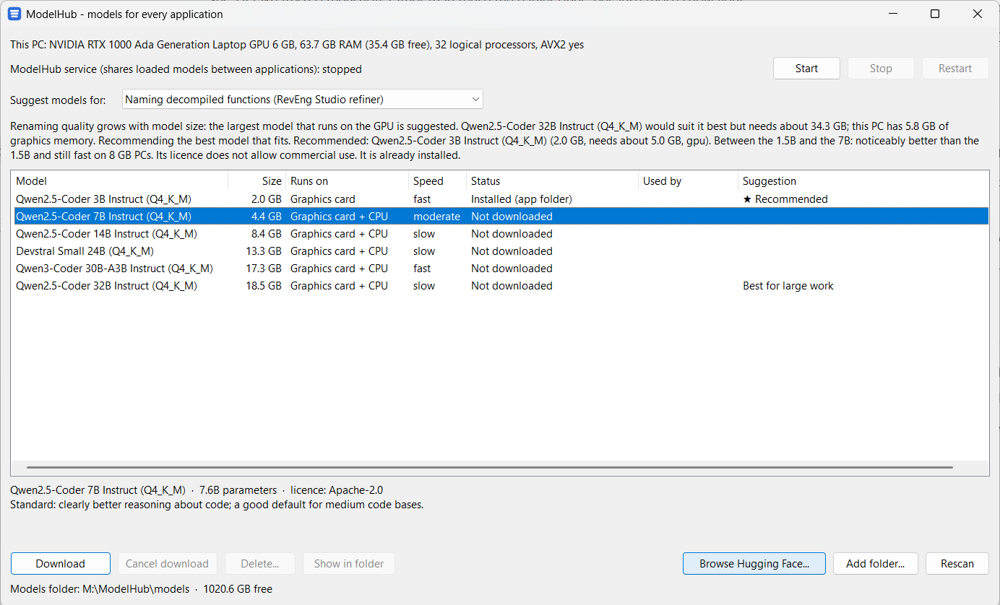
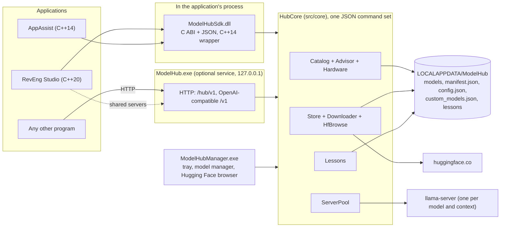
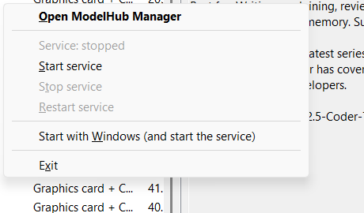
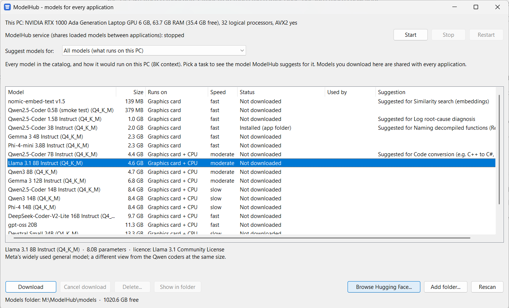
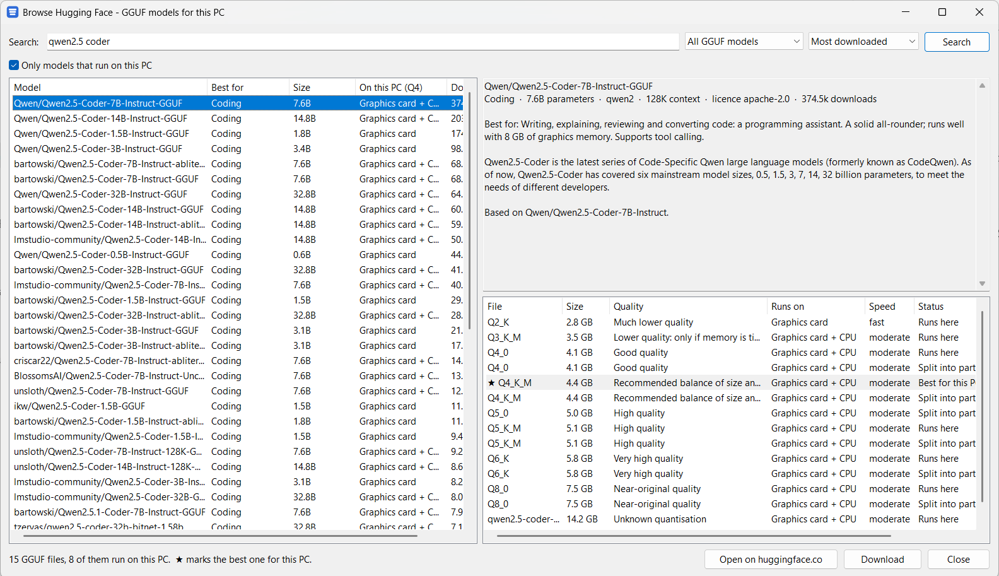

# ModelHub

Everything local-LLM applications on a Windows PC share about models and llama.cpp, in one place.

- **One store.** Models live in `%LOCALAPPDATA%\ModelHub\models`. Folders applications already use are
  searched too, and files found there are used in place. Each model is downloaded once per machine.
- **One catalog.** Every model is pinned by exact size and SHA-256. Task profiles say which models suit which
  job. Applications can add custom models (for example a Hugging Face GGUF) for everyone.
- **Advice.** Which model fits this PC's graphics memory, RAM and disk, and the size of the job.
- **Downloads.** They resume after interruptions, are verified before use, and never run twice for the same
  file on one PC.
- **Lessons.** What applications learn while fixing things is shared: records per key (`lessons_add`,
  `lessons_query`, `lessons_stats`) in `%LOCALAPPDATA%\ModelHub\lessons\<domain>.jsonl`, and a playbook per
  domain (`playbook`, `playbook_add`) in `<domain>.md`. The lessons in `docs/lessons` are brought in at start:
  a new install starts with what earlier projects taught, and an existing one gets the records and playbook
  sections it lacks (nothing it already has is changed). Shipped: `reveng-fix.jsonl` (58 fixes for MSVC and
  javac errors), `reveng-stitch-lessons.md` (how to reproduce and fix stitched projects), `port-fix.jsonl` and
  `port-fix.md` (PortAssistAI: 4 fixes for MBCS -> Unicode and x64 ports, and the compiler documentation notes) and
  `refactor-fix.jsonl` (Refactor Studio: 54 fixes), all in the general form below.
  `python scripts/export_lessons.py [domain ...]` (default `port-fix refactor-fix`, `--dry-run` to look first)
  adds what this PC's hub learned to `docs/lessons`, with a program's own file names and paths hidden
  (`'app.h'` -> `'<file1>.h'`, `C:\src\...` -> `<path>`) and every masked name listed for review.
  Every lesson is kept in a **general form**, whichever application adds it: what the fix did, not whose code it was in. The
  program's own names that the fix keeps on both sides become `name1`, `name2`, ... and a text it keeps unchanged `"text1"`, ...
  (the same placeholder in the lines before, the lines after and the message); comments go and each side starts at column 0.
  What the fix is about stays: a name on one side only (`CharUpperBuffA` -> `CharUpperBuff`, `DWORD` -> `DWORD_PTR`), the
  Windows API, the C and C++ libraries, MFC and ATL, keywords, `ALL_CAPS` macros and types, and format strings
  (`"%d"` -> `"%zu"`): `CharUpperBuffA(joined, 5)` is stored as `CharUpperBuffA(name1, 5)`. An application that replays
  lessons treats the placeholders as wildcards. `ModelHub lessons-clean [--dir <folder>] [--max-lines 3] [--keep-failed]`
  rewrites a lessons folder in this form (the hub's own, or `docs/lessons` before a commit), without failed attempts and
  without fixes longer than 3 lines on either side, each lesson once.
- **llama.cpp.** The pinned, verified `llama-server` build, and servers started on demand (GPU layers chosen
  from the free graphics memory).



It comes in four parts, all built from one core (`src/core`, `HubCore`):

| Part | What it is for |
| --- | --- |
| `ModelHubManager.exe` | For people: an icon in the notification area to start, stop and restart the service, a window that suggests models for this PC and for each task, and downloads and deletes them for every application; and a Hugging Face browser that finds any GGUF model, says what it is best for, and downloads the file that suits this PC. |
| `ModelHubSdk.dll` | In the application's own process: model selection, store, downloads, custom models, llama.cpp servers. A plain C interface (`include/modelhub/modelhub.h`, JSON in and out) with a header-only C++14 wrapper (`modelhub.hpp`). |
| `ModelHub.exe` | The service: the same core over HTTP on `127.0.0.1`, plus a command line (see below). |
| llama.cpp | `llama-server` b11938, downloaded and verified at configure time. |

### Architecture



Every part is a front end of the same `HubCore`, so a command behaves the same in a process, over HTTP and in the
manager. What is shared between applications lives in one folder, `%LOCALAPPDATA%\ModelHub`, under cross-process
locks: the model files and their manifest, the custom models, and the lessons.

### What the service (`ModelHub.exe`) does

`ModelHub.exe serve` runs in the background with no window. Applications reach it at `http://127.0.0.1:39281`
with the token in `%LOCALAPPDATA%\ModelHub\hub.json`. It is optional: applications that use the DLL work
without it.

- **It shares running models.** It starts a `llama-server` for a model when an application first asks for it,
  lets every application use that one server, and stops it after 10 idle minutes. Two applications that both
  use Qwen2.5-Coder 7B load it into graphics memory once, not twice.
- **It speaks HTTP.** It has an OpenAI-compatible `/v1` (chat, completions, embeddings, model list) and
  `/hub/v1/...` for status, the catalog, advice, downloads and deleting. Programs in any language can use it
  without the DLL.
- **Starting it.** Applications start it when they need it (`modelhub_client.h`'s `Connect`). You can start,
  stop and restart it yourself from `ModelHubManager.exe`'s tray icon, or with `ModelHub start` / `ModelHub stop`.
- **One at a time.** Only one ModelHub service runs on a PC, whatever its version or home folder.
  - The service holds the machine-wide mutex `Global\ModelHub.Service`. A second `ModelHub serve` sees it, says
    "ModelHub is already running", and exits with code 0.
  - Versions from before this check don't hold the mutex, so a ModelHub that already answers `/health` for its
    home's `hub.json`, or on the standard port 39281, counts as running too.
  - The service binds its port exclusively (`SO_EXCLUSIVEADDRUSE`), so no other server can share it.
  - A ModelHub that did not start leaves the running one's `hub.json` alone. Earlier versions deleted it on the way
    out, which hid the running service from every client.

## ModelHub Manager

`ModelHubManager.exe` (next to `ModelHub.exe`) puts the ModelHub icon in the notification area. The dot shows
the service: green while it runs, grey when stopped, amber while it starts, stops or a download runs.



- **Tray menu:**
  - *Open ModelHub Manager*. Clicking the icon does the same.
  - *Start service*, *Stop service*, *Restart service*. Stopping or restarting asks first if models are loaded,
    because applications using them get errors until the service runs again.
  - *Start with Windows*: starts the manager in the tray at sign-in, and the service with it.
  - *Exit*. Running downloads stop and resume later.
- **The window:**
  - What this PC has (graphics card and memory, RAM, cores) and the service's state.
  - **Suggest models for**:
    - *All models*: every catalog model, how it would run here (graphics card, graphics card + CPU, CPU, or
      too large), its speed, and the tasks it is suggested for.
    - A task (log diagnosis, code conversion, naming decompiled functions, ...): only that task's models, in
      the order ModelHub ranks them, with *Recommended*, *Start with this* and *Best for large work*, and the
      reasons.
  - For each model: size, status (installed, partly downloaded, downloading with speed and time left) and the
    applications that use it.
  - **Download** (or double-click) downloads into the shared store, with progress. It warns first if the model
    is too large for this PC or the disk is short of space.
  - **Delete...** lists every copy of the model, the applications that use it, and copies in applications'
    own folders, then asks. The files go to the Recycle Bin. If the service is running, it deletes through the
    service, which first stops its `llama-server` of that model. A file that another application has open is
    reported, not deleted.
  - **Browse Hugging Face...** opens the model browser (below).
  - **Add folder...** shares a folder of GGUF files with every application.

  

- **Browse Hugging Face** finds any GGUF model on Hugging Face and downloads the file that suits this PC:
  - **Search** by name, or paste `owner/repo`, `owner/repo/file.gguf` or a huggingface.co address. Filter by kind
    (chat and writing, coding, embeddings) and sort by downloads, trend, likes or date. *Only models that run on
    this PC* hides gated models, models too large for this PC (judged on a typical Q4_K_M file), and speech,
    audio and image models, which llama-server does not run.
  - **Each model shows what it is best for:** chat and writing, coding, reasoning, maths, embeddings, vision +
    text or base model, with a sentence about its size and whether it can call tools. The description comes from
    the original model's card, not the GGUF repackager's notes. You also see its parameters, architecture,
    context length, licence and downloads.
  - **Each of its GGUF files** shows its quantisation, size, quality, whether it runs on the graphics card, the
    graphics card and CPU, or the CPU, and how fast.
    - **Not for this PC:** files for ARM processors (`Q4_0_4_4/4_8/8_8`), split files, files without a SHA-256,
      and gated repositories are marked as such.
    - **★ Best for this PC:** the best quality that runs fully on the graphics card (up to Q8_0), or Q4_K_M on a PC
      without one.
  - **Download** adds the file as a custom model for every application and downloads it like any other (verified
    by SHA-256, resumable); the main window shows the progress. Models are judged with an 8K context; layers and
    KV cache are estimated from the parameters.

  

- **How it runs:** it does its model work in its own process, with the same core as the DLL, so it works
  whether or not the service runs. Everything it changes (the store, custom models, folders) is shared with
  every application. Only one copy runs; starting it again shows the window. Pass `--tray` to start without the
  window, and `--start-service` to start the service.

RevEng Studio and AppAssist use the DLL and have no model code of their own any more (see
*Applications using ModelHub* below).

## ModelHub Chat

`ModelHubChat.exe` (MFC, next to `ModelHub.exe`) is a chat window for the local models, in the style of
llama.cpp's web UI:

- **Sidebar.** *New chat* (Ctrl+N), *Search* (titles and messages), *MCP Servers*, *Model Providers*, *Settings*, and the recent
  conversations grouped by workspace folder. Right-click a conversation to rename it, export it as Markdown, open
  its folder or delete it. The sidebar is laid out like Claude's desktop app, with icons, collapsible folder
  groups, and your name at the bottom. Collapse it with the button at its top right.
- **Environment and Context panel (right).** It shows:
  - *Environment*: this computer, the workspace folder (click to open it, or *Change*), the Git branch, and the model in use.
  - *Context*: about how much of the model's context window the conversation fills. Click to see the breakdown.
  - *Changes*: files the tools wrote or edited. Click one to open it.
  - Close the panel with its ×. Show it again with the button at the top right of the conversation.
- **Resizable panels.** Drag the edge of either side panel to resize it. The widths and which panels are shown are
  saved.
- **Toolbar.** Buttons at the top right of the conversation:
  - Show or hide the right panel.
  - *Tools*.
  - Open a terminal in the workspace folder (Windows Terminal, else PowerShell).
  - Open the workspace folder.
  - *More*: new chat, export, change the folder, MCP servers, providers, settings.
- **Composer.** One row, like Claude's: "+" (attachments and options), the message, ↵ (send) and a microphone.
  - Enter or ↵ sends, and Shift+Enter starts a new line. The box grows with the text, up to eight lines.
  - Escape or the stop button (it replaces ↵ while an answer is written) ends an answer.
  - The microphone starts Windows voice typing (Windows+H), which types into the message box. Below the message box are the status line and three controls:
  - The model: ModelHub's models, plus one submenu per provider. Models that only make embeddings are not listed.
  - The thinking effort.
  - A dot showing whether the models could be listed. Click it to refresh.

  Drop files on the window to attach them. Text files
  and MCP resources are put inline in the message, and images are sent as `image_url` parts (for vision models).
- **Paste.** Ctrl+V (or Shift+Insert, the right-click *Paste*, or *Paste image, files or text* in the "+" menu)
  attaches what is on the clipboard:
  - An image, such as a screenshot or a picture copied from a browser, becomes `pasted-image-N.png`.
  - Files copied in Explorer are attached as if dropped.
  - Text longer than 4,000 characters or 60 lines becomes `pasted-text-N.txt`.
  - Shorter text pastes into the message as usual. When the clipboard holds both text and a picture of it, as
    Word and Excel put there, the text wins.
- **The "+" menu.**
  - *Reasoning*: Default, Off (`enable_thinking: false`), Low, Medium or High (`reasoning_effort`).
  - *Add files*.
  - *System Message*: for this chat, or for every new chat.
  - *Tools*: a check box for each tool, grouped as *Built-in* and one group per MCP server.
  - *MCP Servers*: turn each server on or off.
  - *MCP Resources*: attach a server's resource.
  - *Auto mode...* and *Model providers...* (below).
- **Answers** stream in, with the model's reasoning in grey and the tokens per second in the status line. Tool
  calls run in a loop until the model answers, at most 25 rounds by default. Each answer names its model.
- **Copy.** Every code block has a *Copy code* button above it, and every answer a *Copy answer* button below it.
  They copy the text as written, without the Markdown fences.
- **Built-in tools.** They work in the conversation's workspace folder (*Change folder...*):
  - `read_file`, `file_glob_search`, `grep_search`
  - `exec_shell_command` (cmd.exe or PowerShell, with a timeout)
  - `write_file`, `edit_file`
  - `get_datetime`

  Shell commands, writes and edits ask first. You can turn the asking off in Settings.
- **MCP servers.** A local command (stdio, e.g. `npx -y @modelcontextprotocol/server-memory`) or a URL
  (streamable HTTP, with an optional bearer token). The model sees their tools as `<server>__<tool>`. A server's
  processes run in a job object, so they end with the window.
- **Where answers come from.** By default the ModelHub service. When it is not running, ModelHub Chat starts it as
  it opens, and the status line says so. It looks for `ModelHub.exe` through `install.json`, `MODELHUB_EXE`,
  `PATH`, and then next to `ModelHubChat.exe`. Settings has *Start ModelHub when needed* to turn this off. The
  model's `llama-server` loads on the first message. Settings can point at any other OpenAI-compatible server instead,
  such as `llama-server -m model.gguf --port 8080` (`http://127.0.0.1:8080/v1`).
- **Auto mode** (the first entry in the model list, and the default) picks a model for each message:
  - It sorts the request into *quick*, *general*, *code*, *reasoning*, *agent* (work on files or commands through
    tools) or *images*. The rules look at the words (whole words only), attached files and images, the length of
    the conversation, and whether tools are on. A short reply such as "yes, do it" keeps the conversation's kind.
  - It then scores the models it may use by what suits that kind (coders for code, reasoning models for
    reasoning) and by how they run on this PC: ModelHub's fit (graphics card, graphics card + CPU, CPU) and speed,
    and whether the model is loaded already. ModelHub loads the chosen model, and frees graphics memory from idle
    ones, on the first request.
  - The conversation keeps its model when it is nearly as good, so it is not reloaded for every message. A long
    conversation asks ModelHub for a server with a larger context.
  - A line above the answer says which model was chosen and why. When a model that is not downloaded would be
    clearly better here and fits this PC, the line suggests it with a *Download* button. ModelHub downloads it into
    the shared store, the status line shows the progress, and Auto mode can use it once it is there.
  - *Auto mode...* (in the "+" menu) sets a fixed model for a kind of request. It also turns on two options: a
    small installed model can classify each request too, and download suggestions can be switched off.
- **Model providers.** Models from ChatGPT, Claude, Gemini, GitHub Copilot, other cloud APIs and model servers on
  this PC appear in the model picker next to ModelHub's. See [Models from other providers](#models-from-other-providers)
  for the setup of each one.
- **Ollama's models.** When Ollama has downloaded models (in `%OLLAMA_MODELS%` or `%USERPROFILE%\.ollama\models`),
  ModelHub Chat offers at startup to move them into ModelHub. The same thing is in the "+" menu as *Move Ollama
  models to ModelHub*.
  - The question lists the models and sizes, and says whether Ollama is still installed or running.
  - Each model's GGUF file keeps its SHA-256. It is registered with ModelHub as the catalog model it matches, or
    as a custom model `ollama-<name>` with Ollama's registry URL, so ModelHub can download it again.
  - The file is moved into ModelHub's models folder (a rename on the same disk), and ModelHub verifies it.
  - When every model has moved, Ollama's models folder is deleted. If one cannot move, for example because Ollama
    has it open, the folder is kept. A vision model's image projector is not moved, so it reads text only.
  - *Don't ask again* stops the question; the menu entry stays.
- **Files.** Settings and conversations are kept in `%LOCALAPPDATA%\ModelHub\chat`: `settings.json` and
  `conversations\<id>.json`.

It needs Visual Studio's *C++ MFC* component. `-DMODELHUB_BUILD_CHAT=OFF` skips it.

## Models from other providers

ModelHub Chat can use models from other places next to ModelHub's own. Their models appear in the model picker
below the message box, with one submenu per provider. Two places manage them:

- **Model Providers** (in the sidebar, or the "+" menu) lists the providers, with **Add...**, **Edit...**,
  **Remove** and **Detect**.
- **Model Provider** (from **Add...** or **Edit...**) sets up one provider:
  - **Start from** picks a preset, which fills in the name, API and URL.
  - **API key** takes a key, and **Get a key** opens the page that issues one. **Or the variable** names an
    environment variable that holds the key instead.
  - **Enabled** switches the provider on or off. **Auto mode may use its models** lets Auto mode pick them.
  - **Test** checks the provider by asking it for its models.
  - **Sign in...** runs the provider's own sign-in (ChatGPT, Claude, GitHub Copilot).

### At a glance

| Provider | What you need | How it connects | Cost |
|---|---|---|---|
| ChatGPT | The Codex app (or Codex CLI), signed in with your ChatGPT account | Codex CLI (`codex exec`) | Your ChatGPT plan's Codex usage |
| OpenAI API | An API key from platform.openai.com | OpenAI API | Pay per use |
| Claude | Anthropic's CLI signed in to your Anthropic Console account, or an API key | Anthropic Messages API | Pay per use (Console account) |
| Gemini (and Google Antigravity's models) | A free API key from aistudio.google.com | Gemini's OpenAI-compatible API | Free tier with limits, or pay per use |
| GitHub Copilot | A Copilot subscription and the GitHub Copilot app | Copilot runtime | Your Copilot usage |
| Mistral, OpenRouter, Groq, DeepSeek | An API key from each | Their OpenAI-compatible APIs | Pay per use |
| Ollama, LM Studio, Jan, llama.cpp | The program installed and running | OpenAI-compatible server on this PC | Free; nothing leaves the PC |

The ChatGPT, Claude and Antigravity desktop apps' own sign-ins stay inside those apps. Other programs need an API
key or a CLI sign-in: the Codex CLI for ChatGPT, and Anthropic's CLI for Claude.

### Automatic setup

When ModelHub Chat starts, it imports the providers it finds on this PC. **Detect** in *Model Providers* does the
same at any time. It looks for:

- API keys in environment variables: `ANTHROPIC_API_KEY`, `OPENAI_API_KEY`, `GEMINI_API_KEY` (or
  `GOOGLE_API_KEY`), `MISTRAL_API_KEY`, `OPENROUTER_API_KEY`, `GROQ_API_KEY` and `DEEPSEEK_API_KEY`.
- The Codex CLI's ChatGPT sign-in, which adds *ChatGPT* with the models Codex lists for your account.
- Anthropic's CLI sign-in (`ant auth login`), which adds *Claude*.
- GitHub Copilot, for each GitHub and GitHub Enterprise account that GitHub tools on this PC know. Those tools are
  the GitHub Copilot app, the Copilot and GitHub CLIs, Git Credential Manager and Visual Studio. Only the names of
  their Windows Credential Manager entries are read, never the secrets.
- Ollama, LM Studio (with its configured port) and Jan, installed or running.
- Google Antigravity: if there is no Gemini key, Detect explains how to add one.

A provider is imported once: one you remove stays removed. A provider that is found but not signed in is added
switched off. To stop the import at startup, clear **Import from installed applications when ModelHub Chat
starts** in *Model Providers*.

### Step by step

#### ChatGPT (your ChatGPT sign-in)

This uses your ChatGPT Plus, Pro, Business or Enterprise plan, with no API key.

1. Install the **Codex app** from OpenAI. Or install the Codex CLI on its own: `npm install -g @openai/codex`.
2. Sign in to Codex with your ChatGPT account: open the Codex app once, or run `codex login`.
3. Start ModelHub Chat. *ChatGPT* is imported with your account's models. If it isn't, open **Model Providers**
   and select **Detect**.
4. To set it up by hand instead:
   1. Open **Model Providers**, select **Add...**, and under **Start from** pick **ChatGPT (your ChatGPT
      sign-in, through the Codex app or CLI)**.
   2. Select **Sign in...** if you aren't signed in yet. It runs `codex login` in a command window and opens
      your browser.
   3. Select **Test**: it should list your models (for example GPT-5.6-Luna). Then select **OK**.
5. Pick a model from the **ChatGPT** submenu of the model picker.

Things to know:

- Codex can read files and run read-only commands in the conversation's folder, and they appear in the
  reasoning. It can't change anything.
- The app's own tools and MCP servers aren't passed to Codex.
- Answers arrive all at once, not word by word.
- Each prompt counts toward your plan's Codex usage.

#### OpenAI API (ChatGPT's models with an API key)

1. Create a key at platform.openai.com/api-keys. **Get a key** in the provider window opens that page.
2. Open **Model Providers**, select **Add...**, and under **Start from** pick **ChatGPT models (OpenAI API)**.
3. Paste the key into **API key**. Or set the `OPENAI_API_KEY` environment variable and leave the box empty.
4. Select **Test**, then **OK**.

#### Claude

Your Claude Pro or Max subscription works only in Anthropic's own apps. Here you use your Anthropic Console
account, with a CLI sign-in or an API key.

1. Open the **"+"** menu and select **Set up Claude**. When the Claude app or Claude Code is installed, ModelHub
   Chat also offers this at startup.
2. In the **Claude models** window:
   1. Select **Install Anthropic CLI** if it's missing. It downloads the latest release from
      github.com/anthropics/anthropic-cli, checks it against the release's SHA-256 checksums, and installs it into
      `%LOCALAPPDATA%\ModelHub\tools\ant`.
   2. Select **Sign in...**. It runs `ant auth login` for your Anthropic Console account. The window notices
      when you're done, and the *Claude* provider is added and switched on.
   3. Or select **Use an API key instead...**: create a key at console.anthropic.com/settings/keys and paste it
      into the *Claude* provider's **API key**. Setting `ANTHROPIC_API_KEY` works too.
3. Pick a model from the **Claude** submenu.

#### Gemini (and Google Antigravity's models)

Antigravity's Google sign-in works only inside Antigravity, because Google doesn't allow other programs to use it.
The same Gemini models are available here with a Gemini API key.

1. Go to **aistudio.google.com/apikey** and sign in with your Google account.
2. If **Create a new key** shows "No Cloud Projects Available", create a project first:
   1. Open the project list and choose **Create project**.
   2. Or open **Projects** in AI Studio's sidebar and select **Create a new project**.
   3. Any name works. The free tier needs no billing.
3. Select **Create API key**, choose the project, select **Create key**, and copy the key.
4. In ModelHub Chat, open **Model Providers**, select **Add...**, and under **Start from** pick **Gemini (Google
   AI, OpenAI-compatible)**.
5. Paste the key into **API key** and select **Test**. It should list the Gemini models. Then select **OK**.
6. Instead of steps 4 and 5, you can set the key once in PowerShell, then restart ModelHub Chat:

   ```powershell
   [Environment]::SetEnvironmentVariable("GEMINI_API_KEY", "<your key>", "User")
   ```

7. Pick a model from the **Gemini** submenu.

Things to know:

- On the free tier, new models often answer "HTTP 503: … high demand". Try again later, or use an older model:
  gemini-3.5-flash worked when gemini-3.8-flash didn't.
- Thinking models can take a minute before they start answering. The status line counts the seconds, and Escape
  stops the wait.
- Gemini may call the app's tools without being asked, for example to list files in the workspace folder. The
  tool results are sent to Google. To prevent that, switch tools off with the **Tools** button on the toolbar.

#### GitHub Copilot (github.com or GitHub Enterprise)

1. Install the **GitHub Copilot app** and sign in. Open it once, so that it downloads the Copilot runtime.
2. Start ModelHub Chat. Copilot is imported for each GitHub host this PC has an account on: github.com and, for
   example, `company.ghe.com`.
3. A host shown switched off isn't signed in:
   1. Open **Model Providers**, select it, and select **Edit...**.
   2. Select **Sign in...**. It runs `copilot login` for github.com, or `copilot login --host
      https://company.ghe.com`.
   3. Select **Test**, then switch on **Enabled**.
4. To add a host by hand:
   1. Select **Add...** and pick **GitHub Copilot on GitHub Enterprise Cloud**.
   2. Replace `<host>` in **URL** with your host.
   3. Select **Sign in...**, then **Test**.
5. Pick a model from the **GitHub Copilot** submenu.

Each prompt counts toward the account's Copilot usage. A provider counts as signed in only when the Copilot
runtime's account is on that provider's host.

#### Mistral, OpenRouter, Groq and DeepSeek

1. Create an API key on the provider's site. **Get a key** opens the right page.
2. Select **Add...** and pick the provider under **Start from**.
3. Paste the key, or set the provider's environment variable (`MISTRAL_API_KEY`, `OPENROUTER_API_KEY`,
   `GROQ_API_KEY` or `DEEPSEEK_API_KEY`).
4. Select **Test**, then **OK**.

#### Ollama, LM Studio, Jan, llama.cpp and other local servers

These run on this PC, so nothing leaves it.

1. Install the program and start its server:
   - **Ollama** runs in the background after installation. Its port is 11434, or the one in `OLLAMA_HOST`.
   - **LM Studio**: start its local server. Its port is 1234, or the one in its settings.
   - **Jan**: switch on its local API server. Its port is 1337.
   - **llama.cpp**: run `llama-server -m model.gguf --port 8080`.
2. ModelHub Chat imports the ones it finds. Otherwise:
   1. Select **Add...** and pick the program under **Start from**, or **Other OpenAI-compatible server** with
      the server's `http://.../v1` URL.
   2. Select **Test**, then **OK**.
3. These providers have **Auto mode may use its models** on by default.

Ollama's downloaded models can also move into ModelHub, so that every application using ModelHub can share them.
See *Ollama's models* above.

### Using the models

- **Choosing a model:** select the model name below the message box. ModelHub's own models come first, then one
  submenu per provider. *Refresh the model list* and *Model providers...* are at the bottom.
- **Thinking effort:** the setting next to the model (Default, Off, Low, Medium or High). Each provider gets it in
  its own form: Claude's effort, Codex's `model_reasoning_effort`, Copilot's reasoning effort, or
  `reasoning_effort` for OpenAI-compatible APIs.
- **The dot** next to them is green when the model list loaded, and red when it didn't. Click it to refresh.
- **Auto mode** uses a provider's models only when **Auto mode may use its models** is on. That's on by default for
  providers on this PC and off for cloud ones. Whatever goes to a cloud model (your messages, attached files and
  tool results) leaves the PC and is billed to your account there.
- **Keys** typed into **API key** are stored encrypted for your Windows account (DPAPI) in
  `%LOCALAPPDATA%\ModelHub\chat\settings.json`.

### Troubleshooting

| What you see | What to do |
|---|---|
| A provider is in the list but switched off | It was found but isn't signed in. Select **Edit...**, then **Sign in...**, then **Test**, and switch on **Enabled**. |
| ChatGPT: "not signed in" | Run `codex login`, or **Sign in...** in the ChatGPT provider. |
| ChatGPT: "has not listed this account's models yet" | Open the Codex app once (or run `codex`) so that it fetches your models, then refresh the model list. |
| Claude: "not signed in (run: ant auth login)" | Use **Set up Claude** in the "+" menu. |
| Copilot: "signed in to X, not Y" | The Copilot runtime is signed in to another host. Use **Sign in...** on this provider to add the account. |
| "the API key was not accepted (HTTP 401/403)" | Check the key, or create a new one with **Get a key**. |
| "HTTP 503: … high demand" (Gemini) | Google is overloaded. Try again later, or pick another model. |
| "HTTP 404" for one model | The model has been retired. Refresh the model list and pick another one. |
| The status line counts seconds for a long time | The model is still thinking, or the service is slow. Escape stops the wait. |
| A local server: "cannot connect" | Start the program's server, and check the port in the provider's **URL**. |

### How each provider is connected

- **Claude** goes through Anthropic's Messages API. There is no Anthropic SDK for C++, so the app makes the HTTP
  requests itself.
  - Replies stream with adaptive thinking (a summary of the reasoning is shown).
  - Tools have `eager_input_streaming`, and the thinking effort becomes Claude's effort.
  - Thinking and tool-use blocks go back unchanged on the next request.
  - Server-side fallbacks (`fallbacks: "default"`) are on for the models that support them: if a safety
    classifier declines a request, the API retries it on another model.
  - With the CLI sign-in, the OAuth token is sent as a Bearer token with the `oauth-2025-04-20` beta header.
- **ChatGPT** runs OpenAI's Codex CLI.
  - The CLI is `%CODEX_CLI_PATH%`, else the newest `codex.exe` the Codex app installs in
    `%LOCALAPPDATA%\OpenAI\Codex\bin`, else one on `PATH`.
  - The models come from `models_cache.json` in `%CODEX_HOME%` or `%USERPROFILE%\.codex`.
  - Each answer runs `codex exec --json --ephemeral -s read-only` in the conversation's folder.
  - The prompt holds the conversation so far and comes in on stdin. Images go in with `--image`.
  - `--ephemeral` keeps these chats out of your Codex history.
  - Codex and its helper processes run in a Windows job, so stopping an answer ends them all.
- **Gemini** uses Google's OpenAI-compatible endpoint (`generativelanguage.googleapis.com/v1beta/openai`).
  - Gemini 3 returns a thought signature (`extra_content.google.thought_signature`) with each tool call. It goes
    back with the call on the next request; without it, Gemini 3 rejects a conversation that uses tools.
  - Models that don't chat over this API are left out of the list: Lyria, Genie, Veo, Imagen, Nano Banana, live
    audio, robotics, computer use and AQA.
- **GitHub Copilot** goes through the local Copilot runtime, the engine the GitHub Copilot app and GitHub's
  Copilot SDK use.
  - ModelHub Chat starts `copilot-runtime.exe --headless --no-auto-update --stdio`: the newest one in
    `%LOCALAPPDATA%\github-copilot-sdk\cli`, or `%COPILOT_CLI_PATH%`.
  - There is one runtime per host, with `COPILOT_GH_HOST` set to it, and they end with the app.
  - It speaks JSON-RPC with `Content-Length` framing.
  - Each message is a fresh session (`session.create` with streaming, `session.send`, `session.delete`), with the
    conversation so far as context. Images go as `blob` attachments.
  - Copilot runs its own tool loop, but its built-in shell, file and MCP tools are off (`availableTools` lists
    only the app's tools). It calls the app's tools through `external_tool.requested`, and the transcript shows
    each call. Permission requests are refused.
  - GitHub Models, the HTTP API at `models.github.ai`, was retired on 30 July 2026. Saved providers for it are
    dropped.
- **Google Antigravity** can't be connected directly. Its `agentapi` command only starts conversations inside a
  running Antigravity. Its sign-in and local service are private to the app, and Google blocks other programs
  from using them.
- **OpenAI, Mistral, OpenRouter, Groq, DeepSeek and local servers** use `/v1/chat/completions` with streaming.
  Models that only do embeddings, speech, images or moderation are left out of the list.

## Build

Needs Visual Studio 2022 or 2026 with C++ and its bundled vcpkg (`VCPKG_ROOT`).

```bash
cmake --preset vs2026-x64
```

```bash
cmake --build --preset release
```

- Configuring downloads llama.cpp `b11938` (Vulkan build by default).
- Other backends: `-DMODELHUB_LLAMA_BACKEND=cuda` or `cpu`.
- To use your own llama.cpp, pass `-DMODELHUB_BUNDLE_LLAMA=OFF` and set `llama_server` in `config.json`.
- Archives are cached in `.downloads\` (`-DMODELHUB_DOWNLOAD_CACHE=...`).
- Every build stages the **SDK** in `build\sdk`: what applications build against.

  | Path | Contents |
  | --- | --- |
  | `include\modelhub\` | `modelhub.h` (C interface), `modelhub.hpp` (C++14 wrapper), `modelhub_client.h` (service client) |
  | `lib\<Config>\ModelHubSdk.lib` | import library |
  | `bin\<Config>\` | `ModelHubSdk.dll`, `ModelHub.exe`, `ModelHubManager.exe`, `ModelHubChat.exe` |
  | `bin\catalog.json` | the catalog |
  | `bin\llama\` | llama.cpp's server |
  | `ModelHubConfig.cmake` | for `find_package(ModelHub CONFIG PATHS <ModelHub>/build/sdk)` |

Running the tests:

```bash
bin\Release\ModelHubTests.exe
```

Where things go: the programs (`ModelHub.exe`, `ModelHubManager.exe`, `ModelHubSdk.dll`, the tests) are built into
`bin\<Config>\` at the root of the sources (`-DMODELHUB_OUTPUT_DIR=...` changes it; the `vs2022-x64` preset uses
`bin-vs2022`). CMake's own files and the staged SDK stay in `build\`. Configuring also writes `ModelHub.sln` (the
classic format, Visual Studio 2022 and later) and `ModelHub.slnx` (Visual Studio 2026) at the root, with
`ModelHub` as the startup project; configure again after adding a project. `bin\`, `bin-*\` and both solution
files are build output (in `.gitignore`).

They cover:

- the shared lessons: appending, de-duplication, queries by key and model, several writers at once, the
  playbook, seeding, and the commands over the DLL core and over HTTP;
- the DLL through its C interface and the C++14 wrapper: two "applications" sharing one store; downloads that
  resume, are cancelled or wait for another process; custom models; deleting every copy of a model;
- the HTTP service, including deleting over HTTP;
- the Hugging Face browser's rules (best use, quantisations, model cards, which file suits a PC) and its
  search, judge, add and download steps against a local stand-in for huggingface.co, so they need no network.

The public headers are also compiled as C++14. `HubIntegration.ChatThroughTheHub` runs a real model end to
end: set `MODELHUB_IT_MODEL` to a `.gguf` file from the catalog to enable it. `ModelHubManager.exe` (the windows
and the tray icon) has no automated tests.

## Versions and releases

`.github/workflows/build.yml` builds and tests every pull request and every push to `main`. A push to `main`
also releases:

1. `scripts/next_version.ps1` works out the next version from the last `vMAJOR.MINOR.PATCH` tag and the commit
   messages since then (Conventional Commits):

   | Commits since the last tag | Next version |
   | --- | --- |
   | `feat!: ...`, `fix(store)!: ...` or `BREAKING CHANGE:` in a message | major: 1.4.2 → 2.0.0 |
   | `feat: ...` or `feat(scope): ...` | minor: 1.4.2 → 1.5.0 |
   | anything else (`fix:`, `docs:`, `chore:`, ...) | patch: 1.4.2 → 1.4.3 |

   - Before the first tag, the version is `MODELHUB_VERSION` in `CMakeLists.txt` (0.1.0).
   - Raising `MODELHUB_VERSION` above the last tag makes the next release that version.
   - `[skip release]` in the latest commit message builds and tests without releasing.
2. The build stamps that version (and the run number as the fourth part of the file version) into
   `ModelHubSdk.dll`, `ModelHub.exe`, `ModelHubManager.exe`, `mh_version()` and `ModelHubConfigVersion.cmake`,
   and checks it.
3. The tests run, and CPack zips the SDK as `ModelHub-<version>-win64.zip`, with a `.sha256` file.
4. The workflow creates the tag `v<version>` on that commit and a GitHub release with the zip and notes
   generated from the commits.

The zip has the same layout as `build\sdk`, plus the Visual C++ runtime DLLs, so applications can build
against an unzipped release instead of a local ModelHub build:

```cmake
find_package(ModelHub 0.1 CONFIG REQUIRED PATHS C:/sdk/ModelHub-0.1.0-win64)
```

Local builds are version 0.1.0 unless you pass `-DMODELHUB_VERSION=<version>`.

## Repository layout

| Path | Contents |
| --- | --- |
| `src/core/` | `HubCore` and everything it uses: catalog, advisor, hardware, store, downloader, llama.cpp servers, Hugging Face browsing (`HfBrowse`), shared lessons (`Lessons`) |
| `src/sdk/` | `ModelHubSdk.dll` (the C interface over `HubCore`) |
| `src/hub/` | `ModelHub.exe` (the HTTP service over `HubCore`) |
| `src/chat/` | `ModelHubChat.exe` (MFC chat client: streaming, reasoning, built-in tools, MCP servers) |
| `src/manager/` | `ModelHubManager.exe` (tray icon, model manager and Hugging Face browser, Win32); icons in `res/` (`scripts/make_icons.py`) |
| `docs/images/` | the screenshots in this README |
| `docs/lessons/` | lessons shipped with ModelHub: `reveng-fix.jsonl`, `port-fix.jsonl`, `refactor-fix.jsonl` (fixes for compiler errors) and the playbooks `reveng-stitch-lessons.md`, `port-fix.md`; `scripts/export_lessons.py` adds to them |
| `bin/`, `bin-vs2022/` | build output (not in git): the programs |
| `.clang-format` | the code style (Allman braces, 4 spaces; Visual Studio applies it with "Use ClangFormat") |
| `include/modelhub/` | the public headers (C, C++14 wrapper, service client) |
| `config/catalog.json` | the catalog: models and task profiles |
| `cmake/` | llama.cpp download, the `ModelHubConfig.cmake` template, `RootSolution.cmake` (`ModelHub.sln` / `.slnx` at the root) |
| `scripts/` | `next_version.ps1` (release versions), `make_icons.py`, `merge_catalogs.py` |
| `tests/` | GoogleTest tests |
| `.github/workflows/` | build, test and release |

## Using the DLL

```cmake
find_package(ModelHub CONFIG REQUIRED PATHS ../ModelHub/build/sdk)
target_link_libraries(MyApp PRIVATE ModelHub::Sdk)
modelhub_deploy(MyApp)  # copies ModelHubSdk.dll and catalog.json next to MyApp.exe on every build
```

```cpp
#include "modelhub/modelhub.hpp"  // C++14 or later

modelhub::Sdk hub;
std::string error;
if (hub.Open("{\"app\":\"MyApp\"}", nullptr, &error)) {
    std::string advice = hub.Call("advise", R"({"task":"log-diagnosis","engine":"embedded-cpu",
                                               "workload":{"metrics":{"lines":42000}}})");
    std::string model = hub.Download("qwen2.5-coder-7b", [](const std::string& progress) { return true; });
    std::string server = hub.Call("server_start", R"({"model":"qwen2.5-coder-7b","context_tokens":16384})");
}
```

- **Results** are JSON text: parse them with the JSON library the application already uses. Errors look like
  `{"error": {"message", "type"}, "status": <HTTP-like code>}`.
- **The C interface** is `mh_open`, `mh_call`, `mh_download`, `mh_free` and `mh_close`, usable from any
  compiler or language. The DLL can be delay-loaded, so an application still starts without it.
- **`mh_open` options:**
  - `app`: shown as a user of the models it asks for.
  - `home`: overrides `%MODELHUB_HOME%` / `%LOCALAPPDATA%\ModelHub`.
  - `catalog`: a catalog file to use.
  - `search_dirs`: extra model folders for this process.
  - `llama_server`, `base_port`, `idle_minutes`, `parallel`: for the servers it starts.
  - `scan: false`: don't check model files in the background now.
  - `hf_base`: another Hugging Face address (tests use a local one).

Commands (`mh_call(hub, method, args)`; the same commands serve the HTTP service):

| Command | Arguments | Result |
| --- | --- | --- |
| `status`, `hardware` | | GPU, graphics memory, RAM (total and free), cores, AVX2, store folders, scan state, servers |
| `catalog` | | every model (installed state, path, partial download size, tasks) and every task profile |
| `models` | | installed models |
| `model` | `id`, `app` | one model with its file path (503 while the files are still being checked) |
| `advise` | `task`, `engine` (`hub` or `embedded-cpu`), `workload: {metrics, summary}`, `current`, `context_tokens`, `parallel` | first model, recommended model, notes, and every option with fit, memory, speed, installed |
| `fits` | `context_tokens`, `parallel`, `engine` | fit, memory, GPU layers and speed of every model |
| `add_folder` | `path`, `persist` | shares a folder of GGUF files with every application (kept in `config.json`) |
| `rescan`, `wait_scan` | `timeout_ms` | check model files again / wait for the check |
| `resolve_hf` | `spec` | size and SHA-256 of `owner/repo/file.gguf` |
| `add_model` | `spec`, or `file`, `url`, `size`, `sha256`, plus `id`, `name`, `params_b`, `tools` | adds a custom model (`custom_models.json`) for every application |
| `start_download`, `cancel_download`, `downloads` | `model` | background downloads (the service uses these) |
| `server_start` | `model`, `context_tokens` or `task`, `parallel`, `pin` | starts or reuses a llama-server and answers when it is ready; `pin` keeps it until `server_stop` or `mh_close` |
| `server_stop`, `servers` | `model` | |
| `hf_search` | `query`, `kind` (`text`, `code`, `embeddings`), `sort` (`downloads`, `trending`, `likes`, `updated`), `limit` | GGUF models on Hugging Face, each with category, best use, parameters, architecture, licence and how a Q4_K_M file would run here |
| `hf_repo` | `repo` | one repository: best use, description, notes, every GGUF file judged for this PC (fit, speed, quality, compatible or why not, installed), and the recommended file |
| `hf_add` | `repo`, `file` | adds that file as a custom model (then `mh_download` it) |
| `lessons_add` | `domain`, `records` or `record` (each with a `key`), `app` | appends what an application learned to `lessons\<domain>.jsonl`; identical records (same key, model, removed, added) are skipped; answers `added`, `skipped`, `total` |
| `lessons_query` | `domain`, `keys`, `model`, `limit` (default 50) | the records for those keys (all when none), newest first, the asking model's own first |
| `lessons_stats` | `domain` (optional) | records per domain and key, and whether a playbook exists |
| `playbook`, `playbook_add` | `domain`; `section`, `text`, `app` | the domain's how-to text (`lessons\<domain>.md`), and extending it (nothing is added twice) |
| `delete_model` | `model`, `recycle` (default true) | deletes every copy of the model and its partial download, after stopping this process's servers of it; refuses while it downloads here; lists what was deleted, what failed (a file in use) and who used it |

`mh_download(hub, model, progress, user)` downloads on the calling thread. It reports progress as
`{"phase","done","total","bytes_per_second"}`, and the callback returns non-zero to cancel. If another
process is downloading the same file, it waits for that download; if the files are still being checked, it
waits for the check rather than download something another application already has.

## Command line

```text
ModelHub serve [--background]      run the hub (clients start it with --background)
ModelHub start | stop
ModelHub status                    hardware, store, running llama-servers
ModelHub list                      installed models and where their files are
ModelHub catalog                   all models and tasks (JSON)
ModelHub advise <task> [--engine hub|embedded-cpu] [--metric name=value ...] [--current <model>]
ModelHub pull <model>              download with progress
ModelHub path <model>              the installed file of a model
ModelHub delete <model>            delete every copy of a model (to the Recycle Bin)
ModelHub add-folder <dir>          also use models another application keeps in <dir>
ModelHub rescan
```

For example, `ModelHub advise log-diagnosis --engine embedded-cpu --metric lines=200000` on a 64 GB PC
without a GPU recommends `qwen3-coder-30b-a3b`.

## Files

`%LOCALAPPDATA%\ModelHub` holds everything (override it with `MODELHUB_HOME`):

| File | What it is |
| --- | --- |
| `models\` | Models downloaded through ModelHub. |
| `config.json` | Shared settings: service port (default 39281), `search_dirs`, `llama_server`, `idle_minutes` (10), `parallel` slots (2), `base_port` (39300), `llama_args`. |
| `catalog.json` | Optional. Overrides the catalog shipped next to `ModelHub.exe` / `ModelHubSdk.dll`. |
| `custom_models.json` | Models applications added (`add_model`). |
| `lessons\` | What applications learned: `<domain>.jsonl` (one record per line) and `<domain>.md` (a playbook). Shared by every process; writes hold a machine-wide lock. The repository's `docs/lessons` (shipped in a `lessons` folder next to `ModelHub.exe`) is brought in at start: a missing file is copied, an existing one gets only the records (same key, model, removed, added) and playbook sections (same `##` heading or text) it lacks; what applications added is never changed. |
| `manifest.json` | Every model file found, with its hash, whether it is verified, and which applications use it. Shared by every process; changes are made under a machine-wide lock after re-reading it, and each process picks up the others' changes. |
| `hub.json` | The running hub's port and access token. It is removed when the hub stops. |
| `install.json` | Where `ModelHub.exe` is, so clients can start it. |
| `hub.log` | The hub's log. |

The service and every application using the DLL share this folder. The default `search_dirs` are
`%LOCALAPPDATA%\RevEngStudio\models` and `%LOCALAPPDATA%\AppAssist\models`.
Files in them are recognised by catalog file name and exact size, then hashed once. The result is cached by
path, size and modification time, so a 20 GB file is not re-hashed at every start. These files are never
moved, renamed or deleted.

## HTTP API

Every request except `GET /health` needs `Authorization: Bearer <token from hub.json>`. Only requests whose
`Host` is `127.0.0.1` or `localhost` are answered, so web pages in a browser cannot use the hub.

| Request | What it does |
| --- | --- |
| `GET /hub/v1/status` | Hardware, store folders, scan state, running servers. |
| `GET /hub/v1/catalog` | Models (with installed state and path) and tasks. |
| `POST /hub/v1/advise` | `{"task", "engine": "hub" or "embedded-cpu", "workload": {"metrics": {...}, "summary"}, "current"}` returns the recommended model, the notes explaining why, and every option with its fit. |
| `GET /hub/v1/models` | Installed models. |
| `GET /hub/v1/models/{id}?app=Name` | One model, including its `path`. Answers 503 with `Retry-After` while the store is being scanned. |
| `POST /hub/v1/downloads` | `{"model"}`: starts a download. |
| `GET /hub/v1/downloads` | Download progress. |
| `DELETE /hub/v1/downloads/{id}` | Cancels a download; the partial file resumes next time. |
| `POST /hub/v1/folders` | `{"path"}`: also searches an application's own model folder. Its files are verified once and shared with every application; the folder is kept in `config.json`. |
| `POST /hub/v1/rescan` | Looks for model files again. |
| `POST /hub/v1/fits`, `/hub/v1/resolve`, `/hub/v1/custom-models` | The `fits`, `resolve_hf` and `add_model` commands. |
| `POST /hub/v1/hf/search`, `GET /hub/v1/hf/models/{owner}/{repo}`, `POST /hub/v1/hf/add` | The `hf_search`, `hf_repo` and `hf_add` commands. |
| `DELETE /hub/v1/models/{id}` | Deletes every copy of a model (`?recycle=false`: delete instead of recycling); stops its llama-server first. |
| `POST /hub/v1/servers/{id}/start` | `{"task" or "context_tokens", "parallel"}`: loads the model now and answers when it is ready, so the first chat request is not slow. |
| `POST /hub/v1/servers/{id}/stop` | Stops a model's idle llama-server. |
| `POST /hub/v1/lessons/add`, `/lessons/query`, `/lessons/stats`; `GET /hub/v1/lessons/stats?domain=` | The `lessons_*` commands. |
| `GET /hub/v1/playbook/{domain}`, `POST /hub/v1/playbook/{domain}` | The `playbook` and `playbook_add` commands. |
| `POST /hub/v1/shutdown` | Stops the hub. |
| `GET /v1/models`, `POST /v1/chat/completions`, `/v1/completions`, `/v1/embeddings` | OpenAI-compatible; see below. |

How the OpenAI-compatible requests work:
- `model` is a catalog id, an alias (`qwen2.5-coder:7b`) or a file name.
- Streaming (`"stream": true`) is passed through as server-sent events.
- Optional headers:
  - `X-ModelHub-Task`: use that task profile's context size and parallel slots.
  - `X-ModelHub-Context`: tokens per request.
  - `X-ModelHub-Parallel`: parallel slots.
  - `X-ModelHub-App`: your application's name, shown in `status` and recorded in the manifest.

**Servers.** There is one `llama-server` per model and context size, on ports from 39300. GPU layers are
chosen from the graphics memory still free. When a new model needs room, idle servers are stopped first
(least recently used). A server stops after `idle_minutes` without requests.

## Using the service from an application

Applications that use the DLL don't need the service. It is for sharing running llama.cpp servers between
applications, and for applications that would rather speak HTTP.

### C++ (any standard from C++14)

`include/modelhub/modelhub_client.h` is header-only, uses WinHTTP, and needs nothing else.

```cpp
#include "modelhub/modelhub_client.h"

modelhub::client::Client hub("MyApp");
std::string err;
if (hub.Connect(/*startIfNeeded=*/true, 20000, &err)) {
    hub.EnsureLoaded("qwen2.5-coder-7b", "", 16384, 2);  // loads it now
    // OpenAI requests to hub.BaseUrl() with "Authorization: Bearer " + hub.Token().
}
```

`Connect` starts the service when needed. It looks for `ModelHub.exe` in `install.json`, then
`%MODELHUB_EXE%`, then `PATH`.

### Any language

1. Read `port` and `token` from `%LOCALAPPDATA%\ModelHub\hub.json`.
2. Call the HTTP API.
3. Any OpenAI client library works with `base_url = http://127.0.0.1:<port>/v1` and `api_key = <token>`.

## Applications using ModelHub

- **RevEng Studio** (C++20).
  - Its `ModelRuntime` uses the DLL for the catalog, role suggestions (roles map to tasks), the store,
    downloads, custom Hugging Face models and llama.cpp servers.
  - It uses the service for the servers when it is running (`llm.modelHub` `"auto"`) or always
    (`"service"`).
  - Its build takes llama.cpp and `ModelHub.exe` from the SDK.
  - It no longer has a catalog, downloader or llama-server manager of its own.
- **AppAssist** (C++14).
  - Its `ModelAdvisor` uses the DLL for the catalog, task profiles, `embedded-cpu` advice, the store and
    downloads, and shares its model folders.
  - It still runs models in-process with its embedded llama.cpp, using the file path.
  - It no longer has a catalog, advisor rules or downloader of its own.

## The catalog

`config/catalog.json` (format `modelhub-catalog`) merges the catalogs of AppAssist and RevEng Studio. It was
generated once with `scripts/merge_catalogs.py` and is edited by hand from then on.

**Model fields:**
- `id` and `aliases`.
- `file`, `url`, `size` and `sha256`: the file that gets downloaded.
- `alternates`: other files of the same model, accepted when already present. This is how RevEng's and
  AppAssist's different Qwen2.5-Coder 3B, 7B and 14B downloads are both recognised.
- `params_b`, `active_params_b`, `tier` (1–3), `layers`, `context_k`, `kv_cache_mb_8k`, `tools`,
  `embeddings`, `license`, `summary`.

**Tasks:**

| Task | From | Context | Rule |
| --- | --- | --- | --- |
| `log-diagnosis` | AppAssist | 8K | Starts small; grows with lines and symbols. |
| `code-conversion` | AppAssist | 16K | Sized by the largest file. |
| `port-x64` | PortAssistAI | 16K | Small, local pointer-size fixes: 7B first, 3B for the easy ones. |
| `port-unicode` | PortAssistAI | 16K | Mostly mechanical; text vs. bytes needs 14B or a strong 7B. |
| `port-linux` | PortAssistAI | 16K | Win32 to POSIX rewrites: the strongest model that fits. |
| `binary-renaming` | RevEng refiner | 16K × 3 slots, tool calling | Largest model on the GPU. |
| `rename-review` | RevEng reviewer | 16K, tool calling | Largest model on the GPU. |
| `triage-planning` | RevEng planner | 8K | Small and fast. |
| `embeddings` | RevEng | 2K | `nomic-embed-text`. |

**Fit rules:** a model needs its file size × 1.15, plus the KV cache for the task's context and parallel
slots, plus 1 GB.
- **On the GPU (`gpu`):** up to 92 % of graphics memory.
- **Split across GPU and CPU (`gpu+cpu`):** graphics memory plus up to 60 % of RAM.
- **On the CPU only (`cpu`):** up to 75 % of RAM; up to 90 % is `cpu-tight`.

The recommendation is the first model in the workload tier's preferred list that fits comfortably and fits on
disk. Failing that, it is the first one that fits at all.

**Adding a model:** take `size` and `sha256` from
`https://huggingface.co/api/models/<org>/<repo>/tree/main` (`lfs.size`, `lfs.oid`), then add the model's id
to the `prefer` lists of the tasks that should use it. Use single-file, non-gated repositories.

## Licences

ModelHub is released under the [MIT License](LICENSE).

Each model's licence is in the catalog and shown in its summary; some of them, for example Qwen2.5-Coder 3B,
do not allow commercial use. llama.cpp, cpp-httplib and nlohmann/json are MIT-licensed; their notices are in
[THIRD_PARTY_NOTICES.md](THIRD_PARTY_NOTICES.md), which ships in the release zip.
